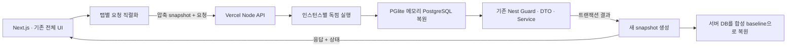
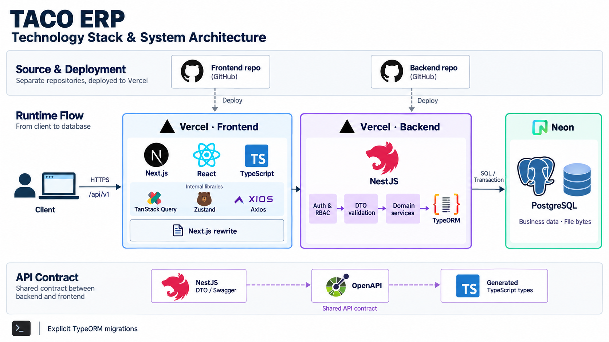

# TACO ERP Portfolio Demo

TACO ERP의 기존 전체 화면과 API를 합성 데이터로 체험하는 공개 데모입니다. 공개 URL은 배포 검증 후 기재합니다.

방문자별 데이터는 현재 브라우저 탭의 메모리에서 관리합니다. 새로고침·탭 종료·체험 초기화 시 처음 상태로 돌아갑니다. 실제 학원 운영 데이터나 외부 발송 서비스에 연결하지 않습니다. [구현 계획](PLAN.md)과 [화면·CRUD 체크리스트](docs/FEATURE-CRUD-CHECKLIST.md)에 구현과 검증 범위를 구분했습니다.

## 체험 방법

로그인 화면에서 대표·매니저·관리자·강사를 선택합니다. 역할별 기존 권한과 저장 검증을 그대로 실행합니다. 체험 중 새로 만든 계정으로도 로그인할 수 있고, 인증 코드는 화면에 표시됩니다. 문자·이메일은 실제로 전송하지 않습니다.

- 공개 계정: `demo-ceo`, `demo-manager`, `demo-admin`, `demo-teacher`
- 공통 체험 비밀번호: `PortfolioDemo!2026` — 실제 운영 계정과 관계없는 공개 값입니다.
- 파일: 파일당 512KiB, 방문자 전체 상태는 압축 1MiB·해제 4MiB까지입니다. 한도를 넘으면 실패를 표시하며 직전 정상 상태를 유지합니다.
- 실제 개인정보와 계정 정보를 입력하지 마세요. 체험 데이터는 API 요청에 포함되며 영구 보관하지 않습니다.

## 실행과 검증

Node.js 22 이상과 npm을 사용합니다. 원본 환경 파일이나 DB 접속 정보가 필요하지 않습니다.

```sh
npm ci
npm ci --prefix backend
npm run build:backend
npm run dev
```

```sh
npm run typecheck
npm run lint
npm test
npm run build
npm run test:demo
DEMO_BASE_URL=http://localhost:3000 npm run test:demo
```

원본의 커밋된 Front `ea499bd`, Back `b74cab3`를 독립 사본으로 이식했습니다. 원본 미커밋 변경·환경·Git 이력은 포함하지 않습니다. 기존 앱을 재사용하므로 새 프레임워크 스타터로 재생성하지 않았습니다.

## 공개 체험 구조



요청마다 방문자가 보낸 상태를 복원하므로 Vercel 인스턴스가 바뀌어도 같은 체험을 이어갑니다. 공유 DB에 방문자 데이터를 보관하지 않습니다. 서버에서는 복원·업무 처리·snapshot 생성·초기화를 하나의 잠금 안에서 실행합니다. 실제 API 309개를 별도 mock 함수로 재작성하지 않고 기존 PostgreSQL SQL과 124개 migration을 사용합니다.

클라이언트가 가진 상태는 사용자가 수정할 수 있는 공개 샌드박스 데이터입니다. 이 구조와 공개 인증 키를 실제 서비스의 인증·영속 DB·보안 모델로 사용하면 안 됩니다. 실제 서버 권한 함수의 실행과 운영 환경의 보안 보장은 구분합니다.

## 폴더와 검증 범위

- `src/app`, `src/components`: 기존 화면·입력·공용 UI
- `src/api`: 기존 API 호출과 생성 DTO 타입
- `src/demo/transport.ts`: 탭 메모리 상태·직렬 요청·초기화
- `src/app/api/demo/route.ts`: 같은 origin의 서버 진입점
- `backend/src`: 기존 Nest 업무 모듈·DTO·SQL·migration
- `backend/demo`: PGlite 호환 드라이버·상태 복원·합성 데이터·발송 대역
- `scripts/verify-demo-api.mjs`: 동일 시나리오를 직접 runtime·로컬 HTTP·배포 HTTP에서 실행
- `docs/evidence`: 비밀값·요청 본문을 제외한 검증 결과

정적 연결은 309/309 API와 31개 route entry(28페이지·3 redirect)를 대조했습니다. 통합 시나리오와 실제 실행한 고유 API 수는 [HTTP 증거](docs/evidence/api-local-http.json)에서 확인할 수 있습니다. 코드 이식 수를 전체 CRUD 검증 완료 수로 설명하지 않습니다. 원본에서 제공하지 않는 일반 학생 프로필 수정 API·UI에 연결되지 않은 레거시 API 등의 경계도 체크리스트에 남겼습니다.

## 제품 기술 스택

아래는 원본 ERP의 기술·배포 구조입니다. 공개 체험판의 메모리 DB 실행 구조는 별도로 문서화합니다.



이미지는 로고·배포 영역·데이터 흐름으로 구조를 표현하도록 내장 image generation 도구로 제작했습니다. [생성 프롬프트](docs/assets/architecture-prompt.txt)는 이미지의 요구사항과 정확한 기술 범위를 기록합니다. 제품의 실제 구현 설명은 원본 소스와 대조했으며 데모 배포 완료나 운영 검증의 증거로 사용하지 않습니다.
