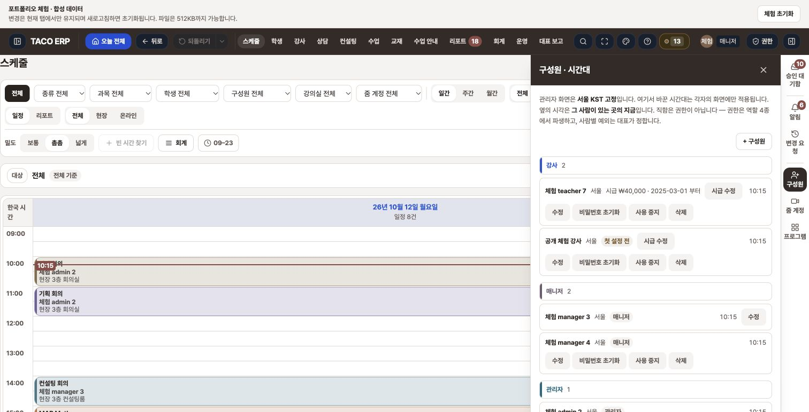
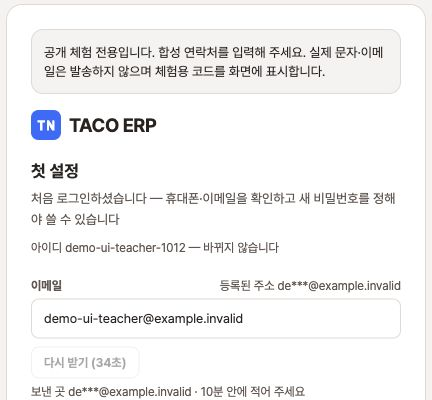

# 공개 데모 새 계정·첫 설정 브라우저 검수

2026-10-12. 대상은 <https://taco-portfolio.vercel.app>이며 CUA Chrome 별도 탭에서 확인했습니다. 검수 배포는 `7a2d0a4`, `dpl_y9bczX2EVtyooVGZFZY36eK21DYt`입니다.

**매니저 로그인 → 합성 강사 생성 → 로그아웃 → 새 계정 로그인 → 첫 설정·체험 코드 표시를 확인했습니다.** 화면 사이에는 앱 내부 이동을 사용해 같은 방문자의 RAM을 유지했습니다.

| 단계 | 실제 관찰 |
|---|---|
| 역할 로그인 | 매니저 버튼으로 일정 화면과 합성 매니저 계정 표시 |
| 생성 권한 | 강사·매니저·관리자 선택 가능, CEO 선택지 없음 |
| 초기 비밀번호 검증 | 공용 초기 비밀번호 재사용 거절 후 별도 임시값으로 생성 |
| 강사 생성 | 생성 성공 안내와 신규 구성원 행 재조회 |
| 신규 로그인 | 로그아웃 후 새 계정으로 로그인해 첫 설정으로 자동 진입 |
| 첫 설정 | 등록된 연락처 마스킹, 코드 발급·비밀번호 입력 경로 확인 |
| 이메일·문자 | 체험 코드, 실제 발송 없음, 유효 시간과 재발급 대기 표시 |
| 검수 종료 | 첫 설정에서 로그아웃 후 로그인 화면 복귀 |

브라우저에서는 새 비밀번호 입력·최종 변경 확인을 제외했습니다. [별도 공개 API 검수](auth-public-http.json)는 첫 설정 완료 `201`, 이후 업무 진입 `200`, 재로그인 `201`과 비밀번호 복구를 확인했습니다. API 완료를 브라우저 완료로 합산하지 않습니다.

비밀번호·OTP 숫자·토큰·쿠키·RAM snapshot은 저장 증거에 남기지 않았습니다. 첫 설정 이미지는 코드 숫자 위까지 네이티브 crop했습니다. 합성 연락처와 방문자 RAM만 사용했으며 실제 메일·문자, 원래 서비스의 계정·운영 DB는 사용하지 않았습니다.

초기 배포에서는 로그인 역할 선택 전 runtime 준비 오류가 표시됐고 재시도 한 차례도 실패했습니다. 부모 담당자가 같은 오류를 재현하여 중단한 뒤 [서버리스 시작 오류 진단과 복구](serverless-startup-diagnosis.md)를 수행했습니다. 위 성공 결과는 복구한 새 배포에서 다시 실행한 결과입니다.

정본: [browser-public-onboarding.json](browser-public-onboarding.json). 로컬 [전체 진입점 검수](browser-navigation.md)는 별도 환경의 관찰 범위를 유지합니다.
